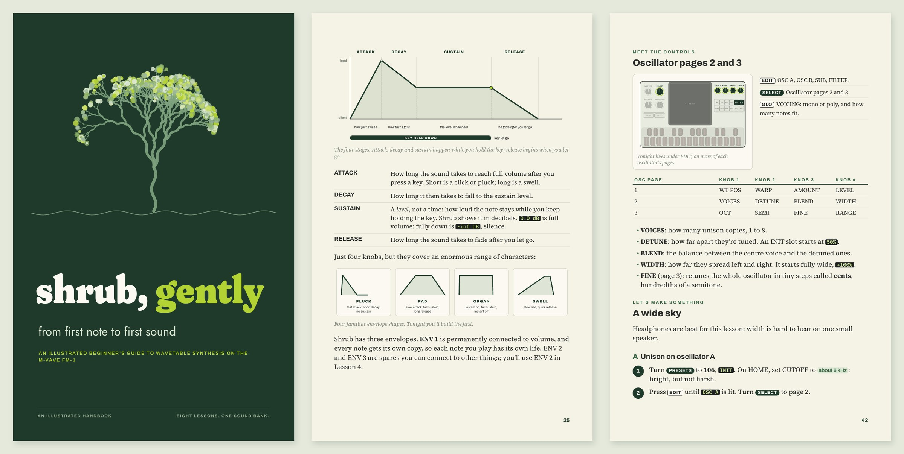
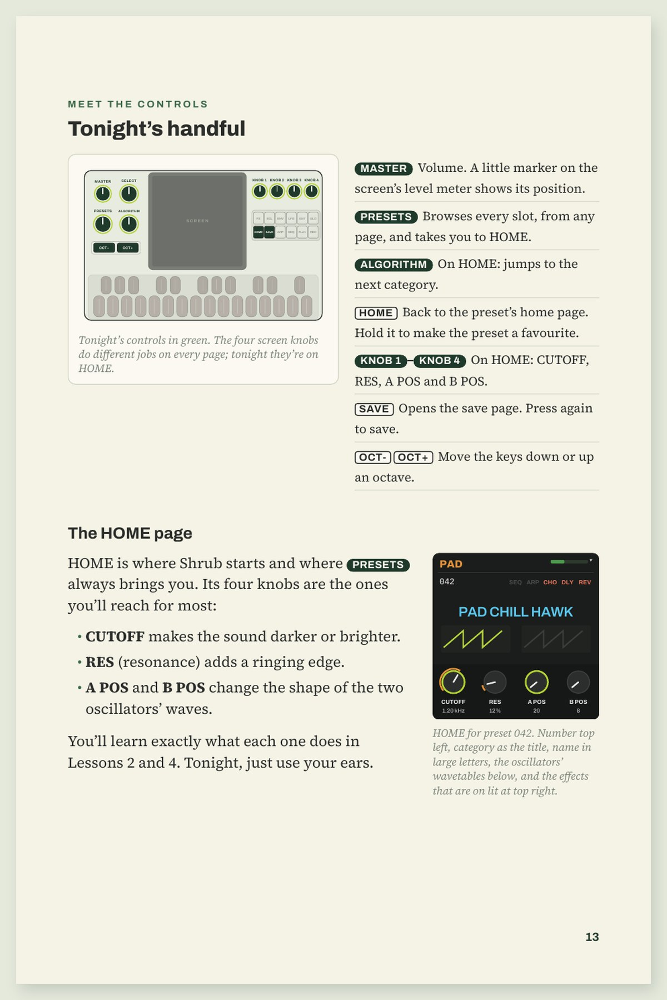
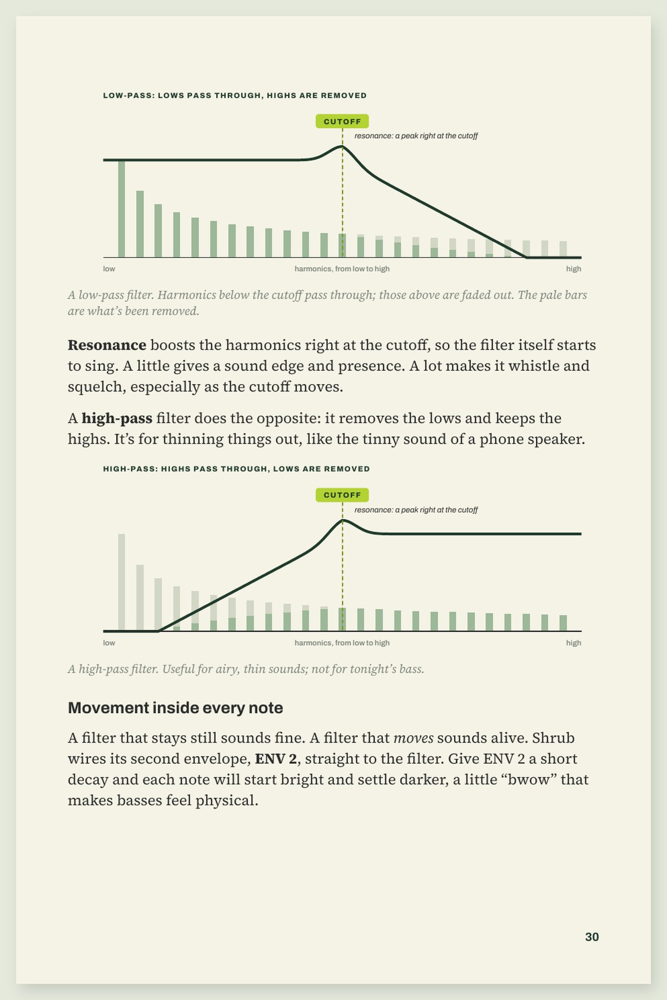

<p align="center">
  
</p>

<p align="center">
  <a href="LICENSE.md"></a>
  <a href="https://github.com/slowphase/shrub-gently/releases"></a>
</p>

*A free, illustrated beginner's handbook to wavetable synthesis on the M-VAVE FM-1 running [SHRUB](https://shrub.audio/), Steve Duda's free firmware.*

Not an equipment manual. Not a music-theory course. Just eight approachable lessons with your FM-1 and a pair of headphones, no computer needed, turning someone who has never touched a synthesiser into someone who can build the sounds they imagine.

No prior musical knowledge required.

---

## Download the handbook

| Edition | Best for | Size | Download |
| --- | --- | --- | --- |
| **iPad mini** (160 × 244 mm) | Portrait reading on the iPad mini, or any tablet or computer | 68 pages | [**Download the PDF**](https://github.com/slowphase/shrub-gently/releases/latest/download/Shrub-Gently.pdf) |
| **Editable source** | Revising the guide or adapting it, within the [licence](LICENSE.md) | ZIP archive | [**Download the source**](https://github.com/slowphase/shrub-gently/releases/latest/download/Shrub-Gently-source.zip) |

There is one edition, sized for comfortable reading on an iPad mini without zooming. The same source is also in the [`source/`](source/) folder.

**Rebuilding the PDF** needs WeasyPrint 70.0 exactly; the pinned versions are in [`source/book/requirements.txt`](source/book/requirements.txt):

```
cd source/book
python3 -m venv .venv && source .venv/bin/activate
pip install -r requirements.txt
python3 build.py
```

Full instructions are in [`source/README.md`](source/README.md#building).

**Handbook:** v0.9.2 Preview · **Firmware documented:** SHRUB V1.04 · **Status:** checked against the official Operation Guide and emulator; hardware testing pending

Future versions will appear on the [Releases page](https://github.com/slowphase/shrub-gently/releases).

> **A note on this edition.** Every instruction was checked against the official *SHRUB Operation Guide* for firmware V1.04, and screen labels, starting values, polyphony and arpeggiator saving were confirmed on the FM-1 emulator running the official firmware. The lessons have not yet been worked through on a physical FM-1. The behaviours still to confirm are listed [below](#version-compatibility). If something on your unit behaves differently from the book, please [tell us](#corrections-and-feedback).

---

## A look inside

<p align="center">
  
</p>

<p align="center">
  
  &nbsp;
  
</p>

<p align="center"><sub>A calm, green look for evening sessions · each lesson lights up only the controls it uses · pictures that explain the sound, not just the buttons.</sub></p>

---

## What you'll learn

Each lesson introduces one or two ideas, shows why they matter musically, then has you build a sound and save it. By the end you have a bank of ten original patches:

1. **Hello, Shrub.** Browse the presets, shape one with your hands, save it as your own.
2. **The Shape of Sound.** Oscillators, pitch, harmonics and wavetables: a tone built from nothing.
3. **Give It a Life.** Envelopes, attack to release: a soft plucked sound.
4. **Dark and Bright.** Filters, cutoff and resonance: a warm, deep bass.
5. **Sounds That Move.** LFOs and modulation: a slowly evolving pad.
6. **More Than One Voice.** Unison, detune and layering, and what thickness costs: a wide synth for chords.
7. **Space and Motion.** Delay, reverb and the arpeggiator: a spacious, moving pattern.
8. **Your First Sound Bank.** Three recipe sounds, a sound of your own with no recipe at all, a tidy bank, and an optional recording into an Akai MPC Sample.

Lessons 1 to 7 take 30 to 45 minutes each; Lesson 8 splits happily over two sittings. Everything happens on the FM-1 itself. The browser editor and a computer are entirely optional.

The book teaches synthesis, with the FM-1 as the instrument. The ideas carry over to almost any synthesiser you play next. When you want every feature, it points you to Steve Duda's own Operation Guide.

## Who it's for

- Complete beginners to synthesisers and music theory.
- New FM-1 owners who have installed SHRUB and want to make sounds, not memorise menus.
- Anyone drawn to atmospheric music, deep basses, soft plucks and evolving textures.
- MPC owners looking for a small, standalone source of original sounds to sample.

---

## About SHRUB and the FM-1

The **M-VAVE FM-1** is a pocket-sized, battery-powered synthesiser with a colour screen, seven endless knobs and 27 keys. **SHRUB** is a free firmware for it by Steve Duda (Xfer Records), described by its author as a stripped-down version of Serum: two wavetable oscillators, Serum's filters, envelopes and LFOs, a 16-slot modulation matrix, an effects rack, an arpeggiator and a motion sequencer.

- [SHRUB home page](https://shrub.audio/)
- [Official SHRUB Operation Guide](https://shrub.audio/guide/)
- [Installer (official instructions)](https://shrub.audio/editor/install)
- [Browser editor](https://shrub.audio/editor/) and [emulator](https://shrub.audio/play)

Please install and update SHRUB using the official instructions on shrub.audio, not this handbook.

*Shrub, Gently* is an independent educational publication. It is not made, endorsed or supported by Xfer Records, Xfer Inc. or M-VAVE.

---

## Version compatibility

The handbook has its own version number, separate from the firmware it describes. "v0.9.2" is the version of this book; "V1.04" is the SHRUB firmware it was written for.

| | Status |
| --- | --- |
| Handbook | v0.9.2 Preview |
| Documented firmware | SHRUB V1.04 |
| Reference documentation | *SHRUB Operation Guide* v1.0 (November 2026) |
| Hardware testing | Pending |
| Newer firmware | Consult the [Operation Guide](https://shrub.audio/guide/); SHRUB is changing quickly |

These behaviours still need confirming on a real FM-1:

- How many notes the VOICING page shows for the book's patches. The guide says up to four notes; the emulator showed up to eight on a plain sound.
- Whether EDIT always opens OSC A, or reopens the part you visited last.
- That an LFO with BIPOLAR off pushes its destination only one way.
- That a saved, latched arpeggio recalls exactly, and that changing preset (not PLAY) stops it, while recorded sequencer lanes keep playing until PLAY stops them.
- Recording levels when sampling the FM-1 into an MPC Sample.

The lessons are written so that none of these can stop you finishing. The full list, with how each item was checked, is in [`source/book/docs/RESEARCH-AND-VERIFICATION.md`](source/book/docs/RESEARCH-AND-VERIFICATION.md).

---

## Corrections and feedback

Spotted a wrong button, a screen that looks different, a sound that behaves unexpectedly, a diagram mistake or a step that didn't make sense? Please [open an issue](https://github.com/slowphase/shrub-gently/issues/new/choose). There are two short forms:

- **Technical correction:** something in the book does not match what SHRUB on the FM-1 actually does.
- **Documentation or design improvement:** something could be clearer, kinder or easier to read.

No question is too small, and beginners' reports are especially welcome: you are exactly who the book is for.

---

## Also in the series

- [**SLOOP, Gently**](https://github.com/slowphase/sloop-gently): the FM-1 with SLOOP firmware.
- [**MPC, Gently**](https://github.com/slowphase/mpc-gently): from first pad to first track on the Akai MPC Sample.

---

## Credits and licences

- **Steve Duda** and **Xfer Inc.**, maker of SHRUB. The handbook was checked against the official *SHRUB Operation Guide*.
- **Joakim Eriksson**, author of the FM-1 emulator used to confirm screen labels and behaviour.
- Typeset in **Archivo**, **Source Serif 4**, **IBM Plex Mono**, **Michroma**, **Fraunces** and **Jost** (SIL Open Font License 1.1).
- All diagrams, panel drawings and screen illustrations are this project's own; there are no screenshots or third-party artwork in the book.
- The handbook was developed with AI-assisted research, writing, coding, layout and review, and went through repeated rounds of review against the official documentation.

Full details, including what you may reuse and how: [CREDITS.md](CREDITS.md) and [LICENSE.md](LICENSE.md).

<sub>"SHRUB" and "Serum" are trademarks of Xfer Records. "M-VAVE" and "FM-1" are trademarks of their owners. "MPC" and "MPC Sample" are trademarks of inMusic Brands, Inc. They are used here only to describe the products.</sub>
